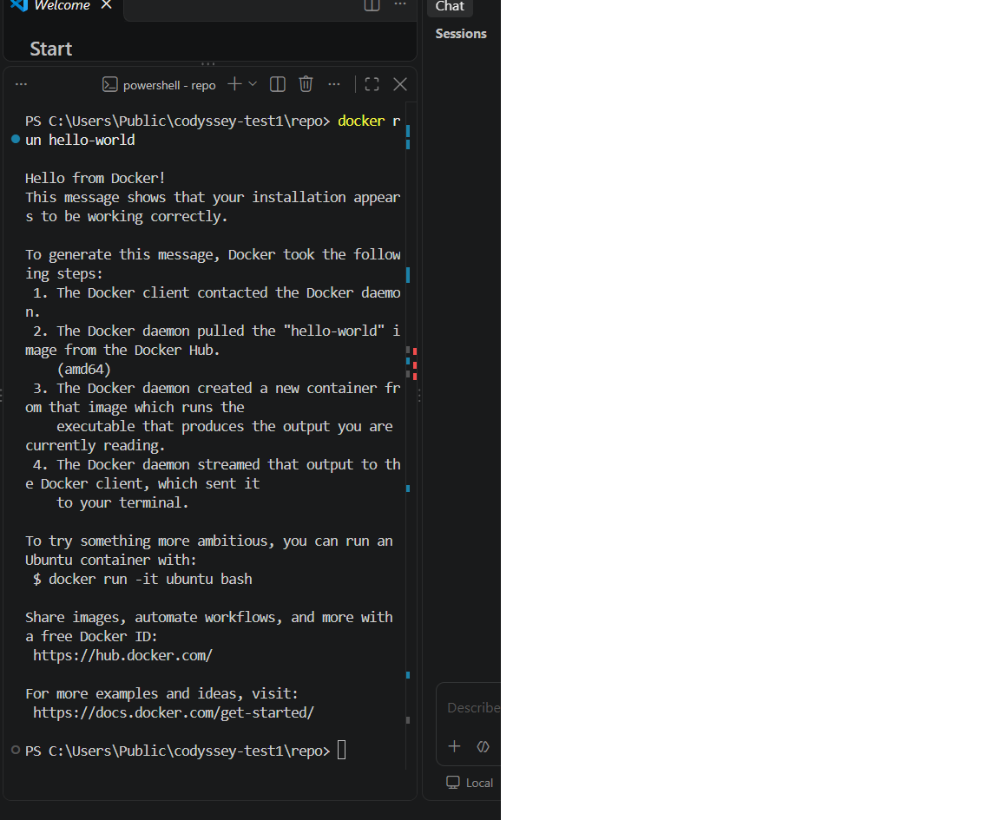
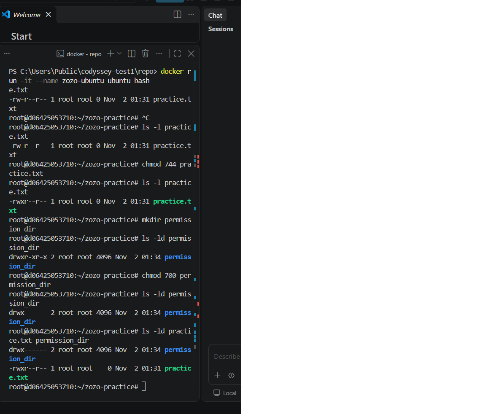
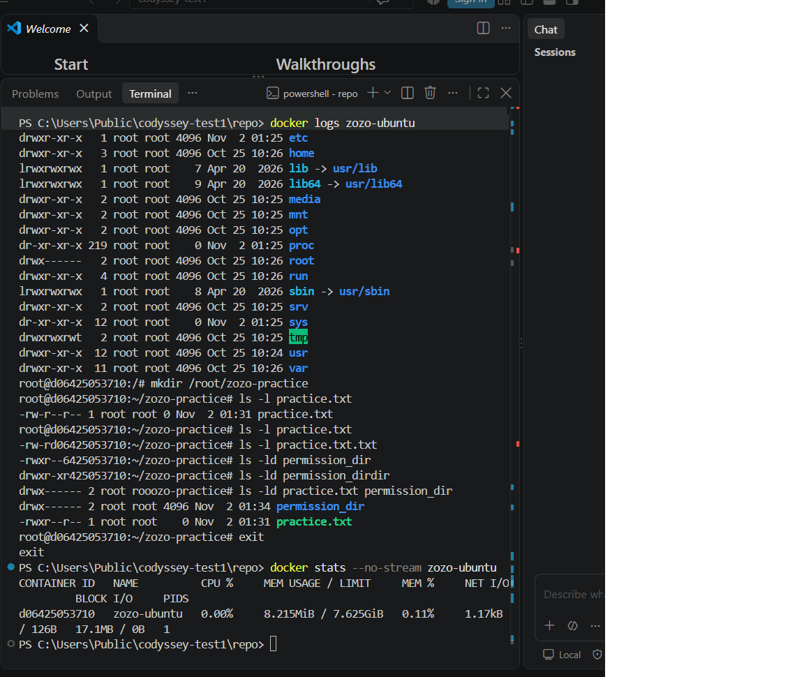
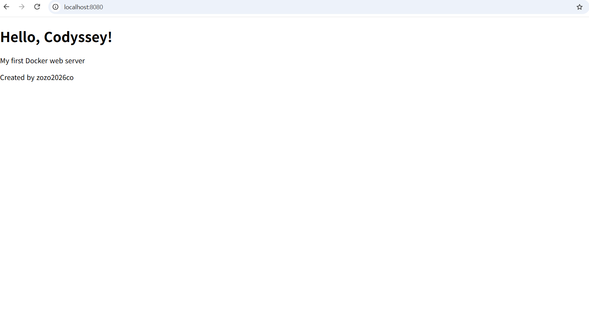
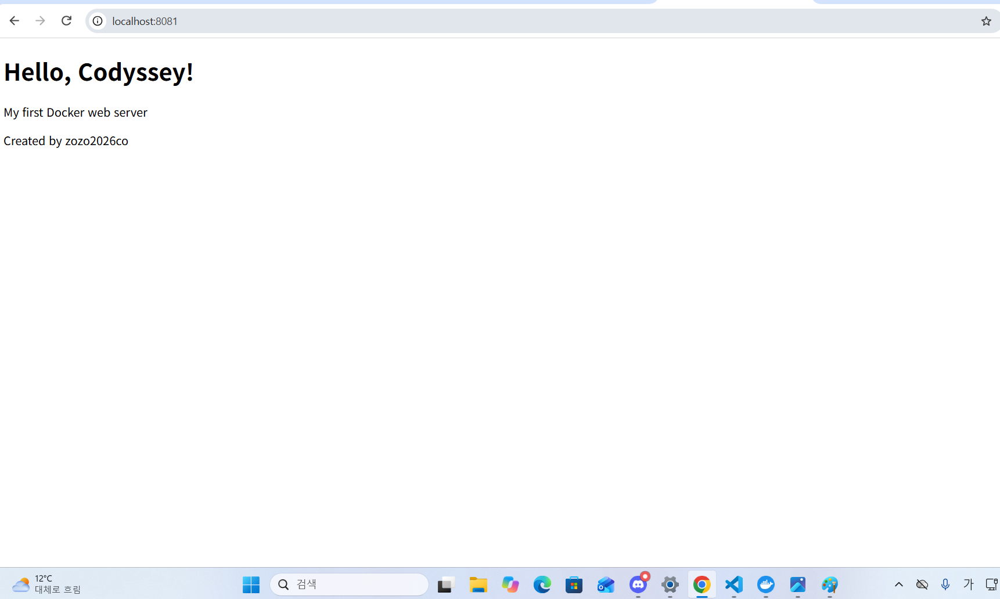
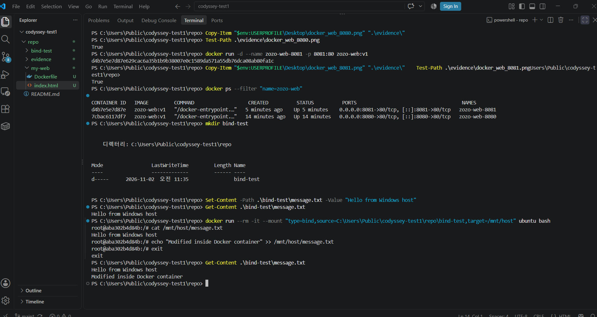
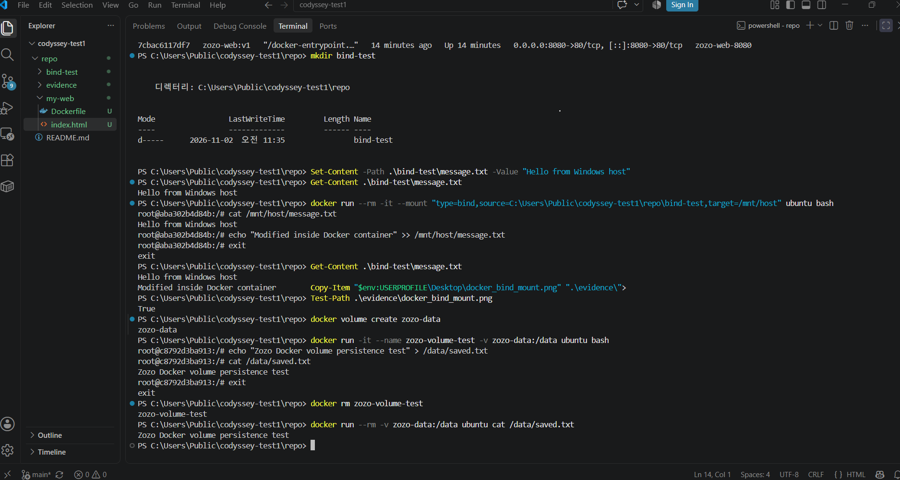
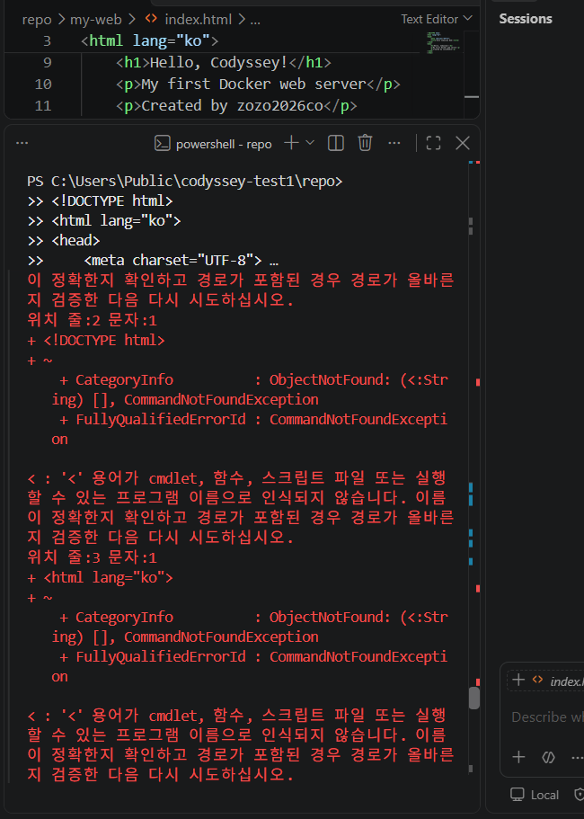
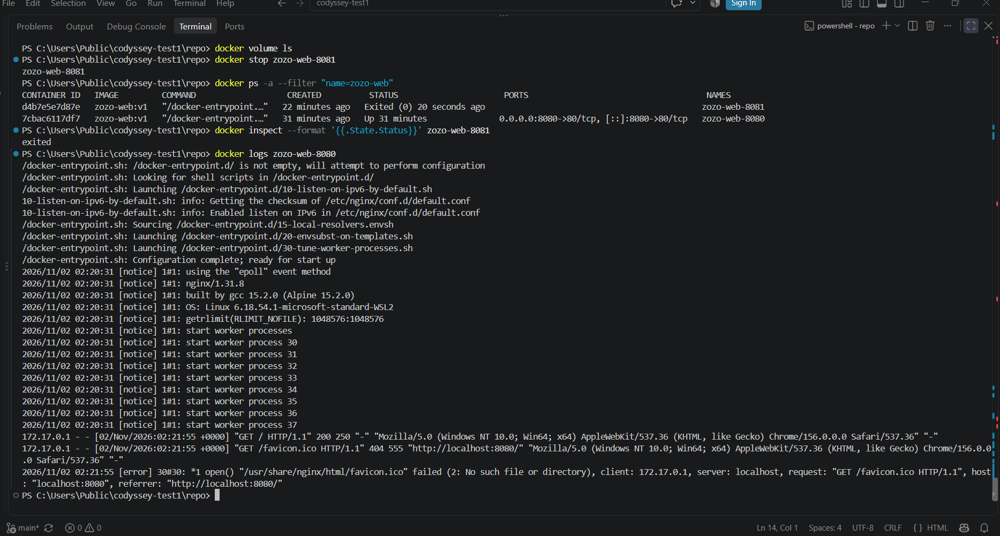
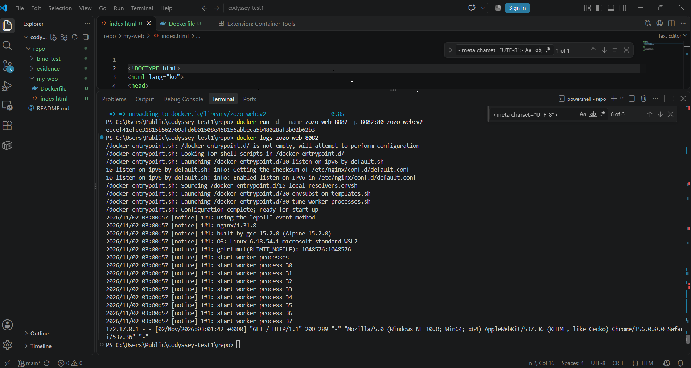

# codyssey-test1
# Codyssey Mission 1 — 개발 환경 구축 및 Docker 실습

## 1. 과제 개요

- **과제명:** 내 컴퓨터에 개발자용 '작업실' 꾸미기
- **GitHub 저장소:** https://github.com/zozo2026co/codyssey-test1
- **실습 환경:** Windows, VS Code, PowerShell, Git, Docker Desktop

이번 과제에서는 개발에 필요한 기본 환경을 직접 설치하고, Git과 Docker를 활용하는 방법을 실습했습니다.

개발 도구와 터미널 명령어가 아직 익숙하지 않아 처음에는 어려운 부분이 있었지만, 명령어를 하나씩 실행하고 결과를 확인하면서 진행했습니다. 오류가 발생했을 때는 원인을 확인하고 수정하는 과정도 함께 경험했습니다.

단순히 프로그램을 설치하는 것뿐 아니라, **직접 파일을 관리하고 Docker 컨테이너를 실행하여 웹페이지까지 만들어 보는 것**을 목표로 했습니다.

## 2. 주요 실습 내용

이번 과제에서 진행한 내용은 다음과 같습니다.

- **개발 환경 구축:** Git, VS Code, Docker Desktop을 설치하고 정상적으로 실행되는지 확인했습니다.
- **Git 및 GitHub:** 저장소를 복제하고 Git 설정과 파일 변경 상태를 확인했습니다.
- **터미널 실습:** PowerShell을 이용해 폴더와 파일을 생성하고, 복사·이동·이름 변경·삭제를 진행했습니다.
- **Linux 실습:** Ubuntu 컨테이너에서 명령어를 사용하고 파일과 디렉터리의 접근 권한을 변경했습니다.
- **Docker 실습:** 이미지와 컨테이너를 생성하고 실행 상태, 로그, 자원 사용량을 확인했습니다.
- **웹 서버 구축:** Dockerfile을 작성하고 NGINX 웹 서버를 실행하여 브라우저에서 웹페이지가 나타나는지 확인했습니다.
- **데이터 관리:** Bind Mount와 Docker Volume을 이용해 파일 공유 및 데이터 유지 여부를 확인했습니다.
- **트러블슈팅:** 실습 중 발생한 오류의 원인을 살펴보고 수정한 뒤 결과를 다시 검증했습니다.

## 3. 실습 기록 및 결과

각 실습에서는 직접 실행한 명령어와 실제 출력 결과를 기록하고, 필요한 화면은 스크린샷으로 저장했습니다.

특히 오류가 발생한 경우에는 단순히 성공 결과만 남기기보다 **어떤 문제가 있었고, 어떻게 수정했으며, 수정 후 무엇이 달라졌는지** 함께 정리하려고 했습니다.

이후 항목에서는 개발 환경 정보, 주요 명령어, 실습 결과, 트러블슈팅 과정과 증거 자료를 순서대로 정리하겠습니다.
## 4. 개발 환경 및 설치 버전

이번 실습은 Windows 11 환경에서 VS Code의 PowerShell 터미널을 사용하여 진행했습니다.

설치한 프로그램이 정상적으로 작동하는지 명령어를 직접 실행해 확인했습니다.

| 항목 | 확인 결과 |
|---|---|
| 운영체제 | Windows 11 Pro |
| OS 버전 | 10.0.26300 (빌드 26300) |
| 터미널 | Windows PowerShell 5.1.26100.9711 |
| Git | 2.56.0.windows.4 |
| Docker CLI | 29.9.2 |
| 코드 편집기 | Visual Studio Code |
| 컨테이너 환경 | Docker Desktop |

### 4.1. 버전 확인에 사용한 명령어

**Windows 정보 확인**

```powershell
Get-CimInstance Win32_OperatingSystem | Select-Object Caption, Version, BuildNumber
```

확인 결과: `Microsoft Windows 11 Pro / 10.0.26300 / 26300`

**PowerShell 버전 확인**

```powershell
$PSVersionTable.PSVersion.ToString()
```

확인 결과: `5.1.26100.9711`

**Git 버전 확인**

```powershell
git --version
```

확인 결과: `git version 2.56.0.windows.4`

**Docker 버전 확인**

```powershell
docker --version
```

확인 결과: `Docker version 29.9.2, build a82e528`

처음에는 일부 개발 도구가 정상적으로 인식되지 않는 문제가 있었지만, 설치 상태와 실행 환경을 확인하면서 해결했습니다. 해당 과정은 뒤의 트러블슈팅 항목에서 정리하겠습니다.
## 5. Docker 기본 실습

### 5.1. Docker 실행 확인

Docker Desktop을 실행한 후 PowerShell에서 Docker 명령어가 정상적으로 동작하는지 확인했습니다.

```powershell
docker --version
docker info
docker run hello-world
docker images
docker ps
docker ps -a
```

`docker run hello-world`를 실행했을 때 `Hello from Docker!` 메시지가 출력되는 것을 확인했습니다.

처음에는 Docker 엔진에 연결되지 않는 문제가 있었지만, Docker Desktop을 실행한 후 정상적으로 명령어를 사용할 수 있었습니다.

**실습 증거**



### 5.2. Ubuntu 컨테이너 실행

Ubuntu 컨테이너를 생성하고 내부에서 Linux 명령어를 실습했습니다.

```powershell
docker run -it --name zozo-ubuntu ubuntu bash
```

컨테이너 내부에서 실행한 명령어는 다음과 같습니다.

```bash
pwd
whoami
ls -la
mkdir /root/zozo-practice
touch /root/zozo-practice/practice.txt
```

`pwd`로 현재 위치를 확인하고, `whoami`로 사용자가 `root`임을 확인했습니다. `ls -la`를 사용해 숨김 파일을 포함한 목록도 확인했습니다.

### 5.3. Linux 파일 및 디렉터리 권한 변경

Linux에서는 파일과 디렉터리의 접근 권한을 확인하고 직접 변경했습니다.

**파일 권한 변경**

```bash
cd /root/zozo-practice
ls -l practice.txt
chmod 744 practice.txt
ls -l practice.txt
```

- 변경 전: `-rw-r--r--` (644)
- 변경 후: `-rwxr--r--` (744)

**디렉터리 권한 변경**

```bash
mkdir permission_dir
ls -ld permission_dir
chmod 700 permission_dir
ls -ld permission_dir
```

- 변경 전: `drwxr-xr-x` (755)
- 변경 후: `drwx------` (700)

처음에는 숫자로 표현된 권한의 의미가 익숙하지 않았지만, 변경 전후의 출력 결과를 비교하면서 읽기·쓰기·실행 권한이 어떻게 달라지는지 확인할 수 있었습니다.

**실습 증거**



### 5.4. 컨테이너 관리 및 상태 확인

다음 명령어로 컨테이너의 실행 상태, 로그, 자원 사용량을 확인했습니다.

```powershell
docker start zozo-ubuntu
docker exec -it zozo-ubuntu bash
docker logs zozo-ubuntu
docker stats --no-stream zozo-ubuntu
```

`docker exec`로 실행 중인 컨테이너에 다시 접속해 기존 파일과 권한이 유지되어 있는 것을 확인했습니다.

`docker stats`를 통해 CPU와 메모리 사용량도 확인했습니다.

**실습 증거**


## 6. Dockerfile을 이용한 웹 서버 제작

### 6.1. Dockerfile 및 HTML 작성

이번에는 Docker에서 제공하는 이미지를 실행하는 것에서 한 단계 더 나아가, 직접 웹페이지를 만들고 Docker 이미지로 제작해 보았습니다.

`my-web` 폴더에 `Dockerfile`과 `index.html` 파일을 작성했습니다.

**Dockerfile 내용**

```dockerfile
FROM nginx:alpine
LABEL org.opencontainers.image.title="zozo-codyssey-web"
COPY index.html /usr/share/nginx/html/index.html
EXPOSE 80
```

`nginx:alpine` 이미지를 기반으로 사용하고, 직접 만든 HTML 파일을 NGINX의 웹페이지 경로에 복사하도록 설정했습니다.

HTML에는 `Hello, Codyssey!`라는 제목과 간단한 소개 문구를 작성했습니다.

### 6.2. Docker 이미지 빌드

PowerShell에서 다음 명령어를 실행했습니다.

```powershell
docker build -t zozo-web:v1 .\my-web
```

빌드가 완료된 후 이미지 목록에서 생성 여부를 확인했습니다.

```powershell
docker images zozo-web
```

실제 확인 결과 `zozo-web:v1` 이미지가 생성되었습니다.

### 6.3. 웹 서버 실행 및 포트 연결

직접 만든 이미지를 사용해 두 개의 웹 서버 컨테이너를 실행했습니다.

```powershell
docker run -d --name zozo-web-8080 -p 8080:80 zozo-web:v1
docker run -d --name zozo-web-8081 -p 8081:80 zozo-web:v1
```

각각의 포트로 브라우저에서 접속한 결과, 직접 작성한 웹페이지가 정상적으로 표시되었습니다.

- `http://localhost:8080` — 접속 성공
- `http://localhost:8081` — 접속 성공

**실습 증거**





### 6.4. 컨테이너 중지 및 로그 확인

웹 서버 컨테이너 중 하나를 중지하고 실제 상태가 변경되는지 확인했습니다.

```powershell
docker stop zozo-web-8081
docker inspect --format '{{.State.Status}}' zozo-web-8081
```

상태 확인 결과 `exited`가 출력되었습니다.

이후 실행 중인 8080 웹 서버의 로그를 확인했습니다.

```powershell
docker logs zozo-web-8080
```

로그에서 `GET / HTTP/1.1" 200`이 표시되어 브라우저의 웹페이지 요청이 성공했음을 확인했습니다.

또한 `favicon.ico` 요청에서 `404` 오류가 발생한 것을 확인했고, 이를 수정하는 과정도 추가로 실습했습니다. 자세한 내용은 뒤의 트러블슈팅 항목에 기록하겠습니다.s


## 7. Docker 데이터 관리 실습

### 7.1. Bind Mount를 이용한 파일 공유

이번에는 Windows에서 만든 파일을 Docker 컨테이너에서도 확인하고, 컨테이너에서 수정한 내용이 Windows에도 반영되는지 실습했습니다.

먼저 PowerShell에서 파일을 생성했습니다.

```powershell
mkdir bind-test
Set-Content -Path .\bind-test\message.txt -Value "Hello from Windows host"
Get-Content .\bind-test\message.txt
```

이후 Windows 폴더를 Ubuntu 컨테이너의 `/mnt/host` 경로에 연결했습니다.

```powershell
docker run --rm -it --mount "type=bind,source=C:\Users\Public\codyssey-test1\repo\bind-test,target=/mnt/host" ubuntu bash
```

컨테이너 내부에서 파일을 확인하고 내용을 추가했습니다.

```bash
cat /mnt/host/message.txt
echo "Modified inside Docker container" >> /mnt/host/message.txt
```

컨테이너를 종료한 뒤 Windows에서 파일을 다시 확인했습니다.

```powershell
Get-Content .\bind-test\message.txt
```

실제 출력 결과:

```text
Hello from Windows host
Modified inside Docker container
```

이 결과를 통해 Windows와 Docker 컨테이너가 연결된 파일의 변경 사항을 공유한다는 것을 확인했습니다.

**실습 증거**



### 7.2. Docker Volume을 이용한 데이터 유지

이번에는 컨테이너를 삭제한 뒤에도 데이터가 유지되는지 확인했습니다.

먼저 Docker Volume을 생성했습니다.

```powershell
docker volume create zozo-data
docker run -it --name zozo-volume-test -v zozo-data:/data ubuntu bash
```

컨테이너 안에서 파일을 만들었습니다.

```bash
echo "Zozo Docker volume persistence test" > /data/saved.txt
cat /data/saved.txt
```

이후 컨테이너를 종료하고 삭제한 뒤 같은 볼륨을 새 컨테이너에 연결했습니다.

```powershell
docker rm zozo-volume-test
docker run --rm -v zozo-data:/data ubuntu cat /data/saved.txt
```

실제 출력 결과:

```text
Zozo Docker volume persistence test
```

기존 컨테이너를 삭제한 뒤에도 파일 내용을 확인할 수 있었습니다. 이를 통해 Docker Volume에 저장한 데이터가 컨테이너와 별도로 유지된다는 것을 확인했습니다.

볼륨 목록도 다음 명령어로 조회했습니다.

```powershell
docker volume ls
```

**실습 증거**



### 7.3. Bind Mount와 Docker Volume의 차이

두 방법을 직접 사용하면서 다음 차이를 확인했습니다.

- **Bind Mount:** Windows의 특정 폴더를 Docker 컨테이너와 연결해 파일을 공유했습니다.
- **Docker Volume:** Docker가 관리하는 저장 공간을 사용했으며, 컨테이너 삭제 후에도 데이터가 유지되는 것을 확인했습니다.

처음에는 두 방식이 비슷해 보였지만, 실제로 파일을 수정하고 컨테이너를 삭제해 보면서 각각의 사용 목적을 이해할 수 있었습니다.


## 8. 트러블슈팅 — 실습 중 발생한 문제와 해결 과정

이번 과제에서는 명령어를 실행하는 과정에서 몇 가지 오류가 발생했습니다. 오류 메시지를 확인하고 원인을 찾아 수정한 과정을 기록했습니다.

### 8.1. HTML 코드를 PowerShell에 입력한 문제

**문제 상황**

NGINX 웹페이지를 제작하면서 HTML 코드를 VS Code 편집기가 아닌 PowerShell 터미널에 입력했습니다.

그 결과 `<` 기호를 명령어로 해석하면서 `CommandNotFoundException` 등의 오류가 발생했습니다.

**원인 추정**

처음에는 코드를 작성하는 편집기와 명령어를 실행하는 터미널의 역할을 정확하게 구분하지 못했습니다.

**확인 및 해결 과정**

1. PowerShell에 HTML을 입력했을 때 나타나는 오류를 확인했습니다.
2. VS Code에서 `my-web/index.html` 파일을 열었습니다.
3. HTML 코드를 해당 파일에 작성하고 저장했습니다.
4. `Get-Content .\my-web\index.html`로 파일 내용을 확인했습니다.
5. Docker 이미지를 빌드하고 브라우저에서 웹페이지가 정상적으로 표시되는 것을 확인했습니다.

**배운 점**

HTML 코드는 편집기에서 파일로 작성하고, PowerShell에서는 파일 관리나 프로그램 실행을 위한 명령어를 입력해야 한다는 차이를 알게 되었습니다.

**HTML 입력 오류 실습 증거**



### 8.2. NGINX favicon.ico 404 오류

**문제 상황**

직접 제작한 웹 서버의 로그를 확인하던 중 다음 오류를 발견했습니다.

```text
GET /favicon.ico HTTP/1.1" 404
```

웹페이지 자체는 정상적으로 표시되었지만, 브라우저가 요청한 `favicon.ico` 파일이 없어서 발생한 오류였습니다.

**원인 확인**

NGINX 로그에 다음 메시지가 기록되었습니다.

```text
open() "/usr/share/nginx/html/favicon.ico" failed (2: No such file or directory)
```

해당 경로에 브라우저 아이콘 파일이 없다는 것을 확인했습니다.

**수정 과정**

`my-web/index.html`의 `<head>` 영역에 다음 코드를 추가했습니다.

```html
<link rel="icon" href="data:,">
```

이후 수정한 HTML을 포함하도록 Docker 이미지를 다시 빌드했습니다.

```powershell
docker build -t zozo-web:v2 .\my-web
```

새 이미지를 이용해 8082번 포트에서 웹 서버를 실행했습니다.

```powershell
docker run -d --name zozo-web-8082 -p 8082:80 zozo-web:v2
```

**수정 결과 확인**

브라우저에서 `http://localhost:8082`에 접속했을 때 웹페이지가 정상적으로 표시되었습니다.

```powershell
docker logs zozo-web-8082
```

로그에서는 `GET / HTTP/1.1" 200`을 확인했으며, 해당 접속 기록에는 기존 `favicon.ico 404` 오류가 나타나지 않았습니다.

다만 이번 결과는 확인한 브라우저 접속에 대한 것이므로, 모든 브라우저 환경에서 오류가 발생하지 않는다고 단정할 수는 없습니다.

**오류 발생 전 증거**



**수정 후 검증 증거**



### 8.3. 실습을 통해 알게 된 점

처음에는 오류 메시지가 나타나면 무엇이 잘못되었는지 파악하기 어려웠습니다.

이번 과제에서는 오류 메시지를 그대로 확인하고, 관련 파일이나 설정을 수정한 뒤 같은 작업을 다시 실행해 보는 방식으로 문제를 해결했습니다.

특히 **문제 발생 화면과 수정 후 결과를 함께 남기는 것**이 실습 과정을 정리하는 데 도움이 되었습니다.