# codyssey-test1
# Codyssey Mission 1 — 개발 환경 구축 및 Docker 실습

## 1. 과제 개요

- **과제명:** 내 컴퓨터에 개발자용 '작업실' 꾸미기
- **GitHub 저장소:** https://github.com/zozo2026co/codyssey-test1
- **실습 환경:** Windows, VS Code, PowerShell, Git, Docker Desktop

이번 과제에서는 개발에 필요한 기본 환경을 직접 설치하고, Git과 Docker를 활용하는 방법을 실습했습니다.

개발 도구와 터미널 명령어가 아직 익숙하지 않아 처음에는 어려운 부분이 있었지만, 명령어를 하나씩 실행하고 결과를 확인하면서 진행했습니다. 오류가 발생했을 때는 원인을 확인하고 수정하는 과정도 함께 경험했습니다.

단순히 프로그램을 설치하는 것뿐 아니라, **직접 파일을 관리하고 Docker 컨테이너를 실행하여 웹페이지까지 만들어 보는 것**을 목표로 했습니다.

## 2. 주요 실습 내용

이번 과제에서 진행한 내용은 다음과 같습니다.

- **개발 환경 구축:** Git, VS Code, Docker Desktop을 설치하고 정상적으로 실행되는지 확인했습니다.
- **Git 및 GitHub:** 저장소를 복제하고 Git 설정과 파일 변경 상태를 확인했습니다.
- **터미널 실습:** PowerShell을 이용해 폴더와 파일을 생성하고, 복사·이동·이름 변경·삭제를 진행했습니다.
- **Linux 실습:** Ubuntu 컨테이너에서 명령어를 사용하고 파일과 디렉터리의 접근 권한을 변경했습니다.
- **Docker 실습:** 이미지와 컨테이너를 생성하고 실행 상태, 로그, 자원 사용량을 확인했습니다.
- **웹 서버 구축:** Dockerfile을 작성하고 NGINX 웹 서버를 실행하여 브라우저에서 웹페이지가 나타나는지 확인했습니다.
- **데이터 관리:** Bind Mount와 Docker Volume을 이용해 파일 공유 및 데이터 유지 여부를 확인했습니다.
- **트러블슈팅:** 실습 중 발생한 오류의 원인을 살펴보고 수정한 뒤 결과를 다시 검증했습니다.

## 3. 실습 기록 및 결과

각 실습에서는 직접 실행한 명령어와 실제 출력 결과를 기록하고, 필요한 화면은 스크린샷으로 저장했습니다.

특히 오류가 발생한 경우에는 단순히 성공 결과만 남기기보다 **어떤 문제가 있었고, 어떻게 수정했으며, 수정 후 무엇이 달라졌는지** 함께 정리하려고 했습니다.

이후 항목에서는 개발 환경 정보, 주요 명령어, 실습 결과, 트러블슈팅 과정과 증거 자료를 순서대로 정리하겠습니다.
## 4. 개발 환경 및 설치 버전

이번 실습은 Windows 11 환경에서 VS Code의 PowerShell 터미널을 사용하여 진행했습니다.

설치한 프로그램이 정상적으로 작동하는지 명령어를 직접 실행해 확인했습니다.

| 항목 | 확인 결과 |
|---|---|
| 운영체제 | Windows 11 Pro |
| OS 버전 | 10.0.26300 (빌드 26300) |
| 터미널 | Windows PowerShell 5.1.26100.9711 |
| Git | 2.56.0.windows.4 |
| Docker CLI | 29.9.2 |
| 코드 편집기 | Visual Studio Code |
| 컨테이너 환경 | Docker Desktop |

### 4.1. 버전 확인에 사용한 명령어

**Windows 정보 확인**

```powershell
Get-CimInstance Win32_OperatingSystem | Select-Object Caption, Version, BuildNumber
```

확인 결과: `Microsoft Windows 11 Pro / 10.0.26300 / 26300`

**PowerShell 버전 확인**

```powershell
$PSVersionTable.PSVersion.ToString()
```

확인 결과: `5.1.26100.9711`

**Git 버전 확인**

```powershell
git --version
```

확인 결과: `git version 2.56.0.windows.4`

**Docker 버전 확인**

```powershell
docker --version
```

확인 결과: `Docker version 29.9.2, build a82e528`

처음에는 일부 개발 도구가 정상적으로 인식되지 않는 문제가 있었지만, 설치 상태와 실행 환경을 확인하면서 해결했습니다. 해당 과정은 뒤의 트러블슈팅 항목에서 정리하겠습니다.
## 5. Docker 기본 실습

### 5.1. Docker 실행 확인

Docker Desktop을 실행한 후 PowerShell에서 Docker 명령어가 정상적으로 동작하는지 확인했습니다.

```powershell
docker --version
docker info
docker run hello-world
docker images
docker ps
docker ps -a
```

`docker run hello-world`를 실행했을 때 `Hello from Docker!` 메시지가 출력되는 것을 확인했습니다.

처음에는 Docker 엔진에 연결되지 않는 문제가 있었지만, Docker Desktop을 실행한 후 정상적으로 명령어를 사용할 수 있었습니다.

**실습 증거**

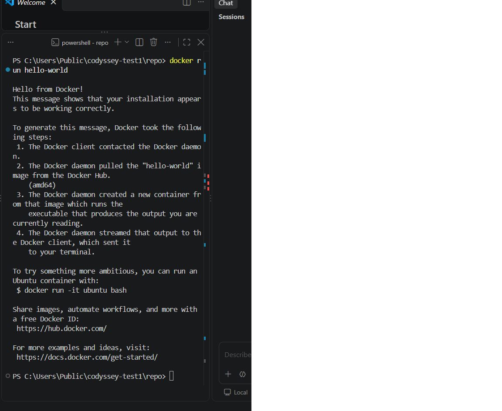

### 5.2. Ubuntu 컨테이너 실행

Ubuntu 컨테이너를 생성하고 내부에서 Linux 명령어를 실습했습니다.

```powershell
docker run -it --name zozo-ubuntu ubuntu bash
```

컨테이너 내부에서 실행한 명령어는 다음과 같습니다.

```bash
pwd
whoami
ls -la
mkdir /root/zozo-practice
touch /root/zozo-practice/practice.txt
```

`pwd`로 현재 위치를 확인하고, `whoami`로 사용자가 `root`임을 확인했습니다. `ls -la`를 사용해 숨김 파일을 포함한 목록도 확인했습니다.

### 5.3. Linux 파일 및 디렉터리 권한 변경

Linux에서는 파일과 디렉터리의 접근 권한을 확인하고 직접 변경했습니다.

**파일 권한 변경**

```bash
cd /root/zozo-practice
ls -l practice.txt
chmod 744 practice.txt
ls -l practice.txt
```

- 변경 전: `-rw-r--r--` (644)
- 변경 후: `-rwxr--r--` (744)

**디렉터리 권한 변경**

```bash
mkdir permission_dir
ls -ld permission_dir
chmod 700 permission_dir
ls -ld permission_dir
```

- 변경 전: `drwxr-xr-x` (755)
- 변경 후: `drwx------` (700)

처음에는 숫자로 표현된 권한의 의미가 익숙하지 않았지만, 변경 전후의 출력 결과를 비교하면서 읽기·쓰기·실행 권한이 어떻게 달라지는지 확인할 수 있었습니다.

**실습 증거**

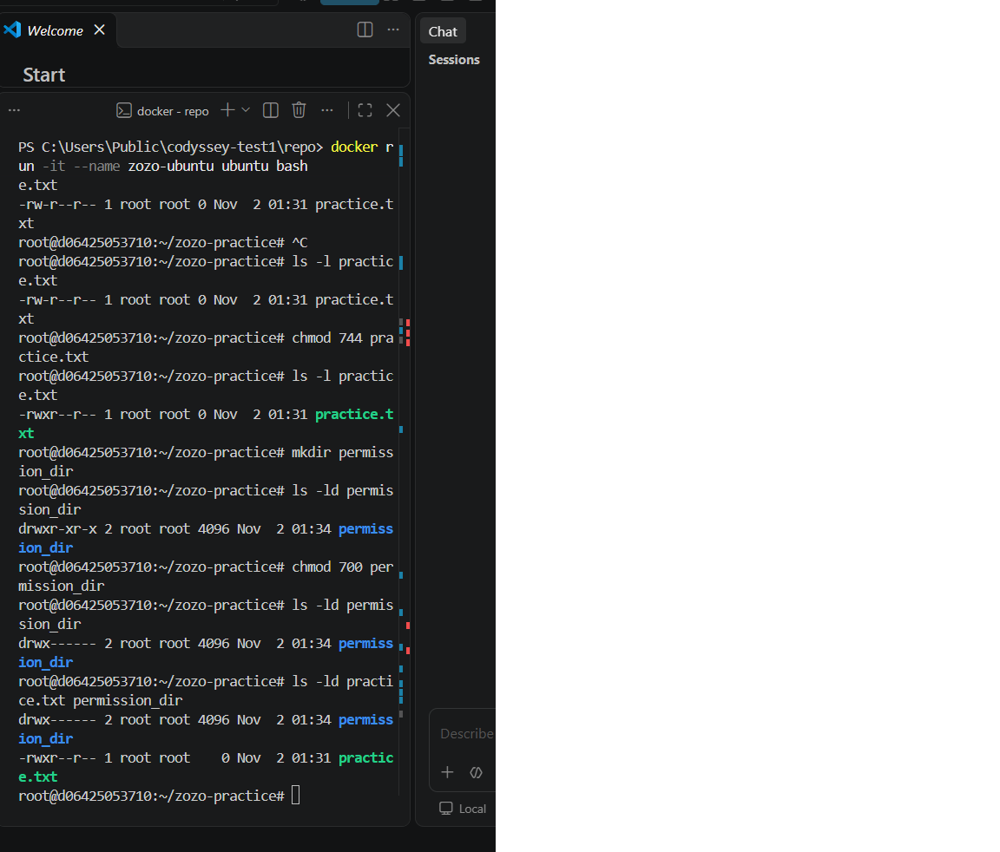

### 5.4. 컨테이너 관리 및 상태 확인

다음 명령어로 컨테이너의 실행 상태, 로그, 자원 사용량을 확인했습니다.

```powershell
docker start zozo-ubuntu
docker exec -it zozo-ubuntu bash
docker logs zozo-ubuntu
docker stats --no-stream zozo-ubuntu
```

`docker exec`로 실행 중인 컨테이너에 다시 접속해 기존 파일과 권한이 유지되어 있는 것을 확인했습니다.

`docker stats`를 통해 CPU와 메모리 사용량도 확인했습니다.

**실습 증거**

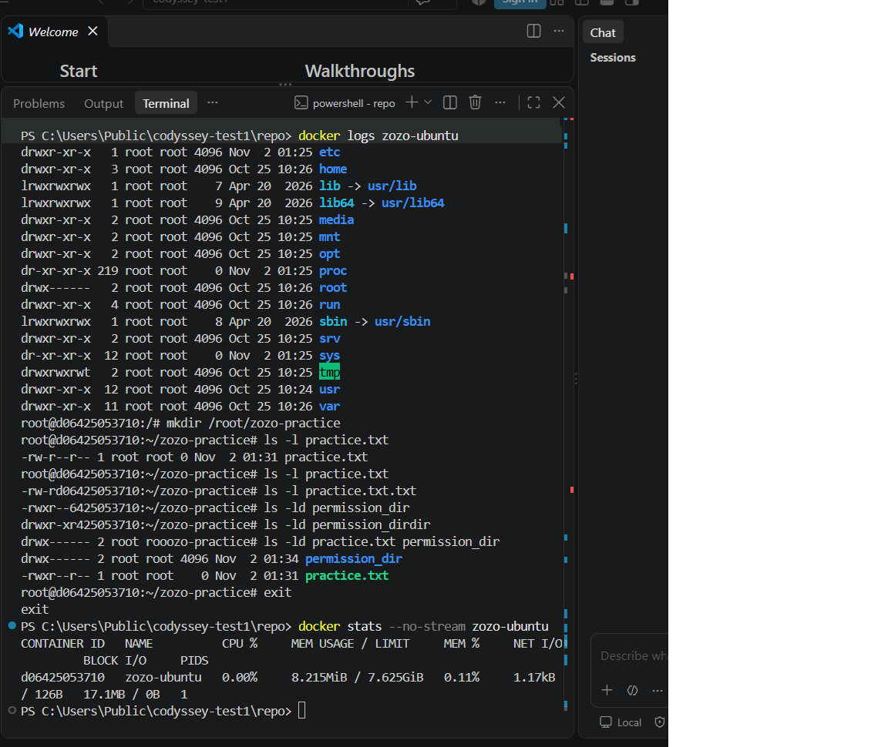
## 6. Dockerfile을 이용한 웹 서버 제작

### 6.1. Dockerfile 및 HTML 작성

이번에는 Docker에서 제공하는 이미지를 실행하는 것에서 한 단계 더 나아가, 직접 웹페이지를 만들고 Docker 이미지로 제작해 보았습니다.

`my-web` 폴더에 `Dockerfile`과 `index.html` 파일을 작성했습니다.

**Dockerfile 내용**

```dockerfile
FROM nginx:alpine
LABEL org.opencontainers.image.title="zozo-codyssey-web"
COPY index.html /usr/share/nginx/html/index.html
EXPOSE 80
```

`nginx:alpine` 이미지를 기반으로 사용하고, 직접 만든 HTML 파일을 NGINX의 웹페이지 경로에 복사하도록 설정했습니다.

HTML에는 `Hello, Codyssey!`라는 제목과 간단한 소개 문구를 작성했습니다.

### 6.2. Docker 이미지 빌드

PowerShell에서 다음 명령어를 실행했습니다.

```powershell
docker build -t zozo-web:v1 .\my-web
```

빌드가 완료된 후 이미지 목록에서 생성 여부를 확인했습니다.

```powershell
docker images zozo-web
```

실제 확인 결과 `zozo-web:v1` 이미지가 생성되었습니다.

### 6.3. 웹 서버 실행 및 포트 연결

직접 만든 이미지를 사용해 두 개의 웹 서버 컨테이너를 실행했습니다.

```powershell
docker run -d --name zozo-web-8080 -p 8080:80 zozo-web:v1
docker run -d --name zozo-web-8081 -p 8081:80 zozo-web:v1
```

각각의 포트로 브라우저에서 접속한 결과, 직접 작성한 웹페이지가 정상적으로 표시되었습니다.

- `http://localhost:8080` — 접속 성공
- `http://localhost:8081` — 접속 성공

**실습 증거**

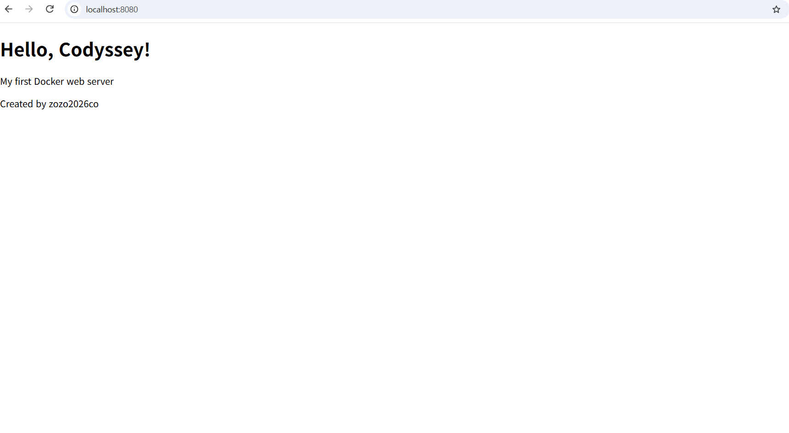

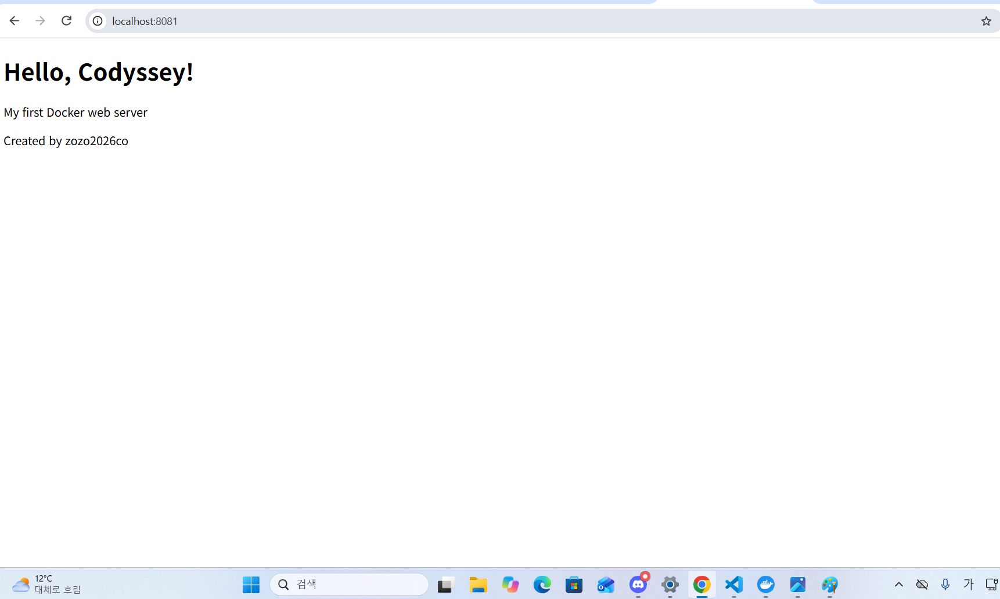

### 6.4. 컨테이너 중지 및 로그 확인

웹 서버 컨테이너 중 하나를 중지하고 실제 상태가 변경되는지 확인했습니다.

```powershell
docker stop zozo-web-8081
docker inspect --format '{{.State.Status}}' zozo-web-8081
```

상태 확인 결과 `exited`가 출력되었습니다.

이후 실행 중인 8080 웹 서버의 로그를 확인했습니다.

```powershell
docker logs zozo-web-8080
```

로그에서 `GET / HTTP/1.1" 200`이 표시되어 브라우저의 웹페이지 요청이 성공했음을 확인했습니다.

또한 `favicon.ico` 요청에서 `404` 오류가 발생한 것을 확인했고, 이를 수정하는 과정도 추가로 실습했습니다. 자세한 내용은 뒤의 트러블슈팅 항목에 기록하겠습니다.s


## 7. Docker 데이터 관리 실습

### 7.1. Bind Mount를 이용한 파일 공유

이번에는 Windows에서 만든 파일을 Docker 컨테이너에서도 확인하고, 컨테이너에서 수정한 내용이 Windows에도 반영되는지 실습했습니다.

먼저 PowerShell에서 파일을 생성했습니다.

```powershell
mkdir bind-test
Set-Content -Path .\bind-test\message.txt -Value "Hello from Windows host"
Get-Content .\bind-test\message.txt
```

이후 Windows 폴더를 Ubuntu 컨테이너의 `/mnt/host` 경로에 연결했습니다.

```powershell
docker run --rm -it --mount "type=bind,source=C:\Users\Public\codyssey-test1\repo\bind-test,target=/mnt/host" ubuntu bash
```

컨테이너 내부에서 파일을 확인하고 내용을 추가했습니다.

```bash
cat /mnt/host/message.txt
echo "Modified inside Docker container" >> /mnt/host/message.txt
```

컨테이너를 종료한 뒤 Windows에서 파일을 다시 확인했습니다.

```powershell
Get-Content .\bind-test\message.txt
```

실제 출력 결과:

```text
Hello from Windows host
Modified inside Docker container
```

이 결과를 통해 Windows와 Docker 컨테이너가 연결된 파일의 변경 사항을 공유한다는 것을 확인했습니다.

**실습 증거**

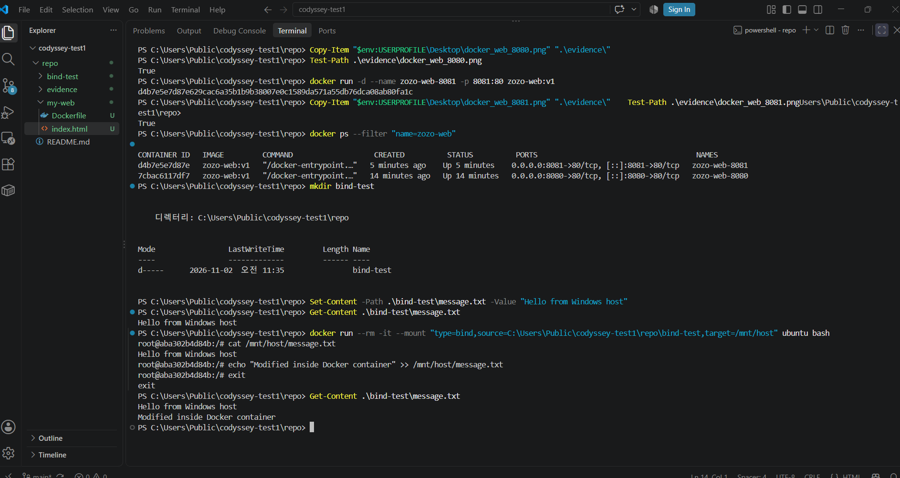

### 7.2. Docker Volume을 이용한 데이터 유지

이번에는 컨테이너를 삭제한 뒤에도 데이터가 유지되는지 확인했습니다.

먼저 Docker Volume을 생성했습니다.

```powershell
docker volume create zozo-data
docker run -it --name zozo-volume-test -v zozo-data:/data ubuntu bash
```

컨테이너 안에서 파일을 만들었습니다.

```bash
echo "Zozo Docker volume persistence test" > /data/saved.txt
cat /data/saved.txt
```

이후 컨테이너를 종료하고 삭제한 뒤 같은 볼륨을 새 컨테이너에 연결했습니다.

```powershell
docker rm zozo-volume-test
docker run --rm -v zozo-data:/data ubuntu cat /data/saved.txt
```

실제 출력 결과:

```text
Zozo Docker volume persistence test
```

기존 컨테이너를 삭제한 뒤에도 파일 내용을 확인할 수 있었습니다. 이를 통해 Docker Volume에 저장한 데이터가 컨테이너와 별도로 유지된다는 것을 확인했습니다.

볼륨 목록도 다음 명령어로 조회했습니다.

```powershell
docker volume ls
```

**실습 증거**

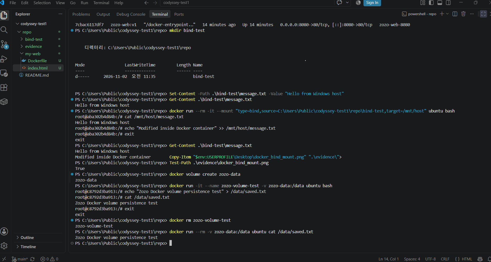

### 7.3. Bind Mount와 Docker Volume의 차이

두 방법을 직접 사용하면서 다음 차이를 확인했습니다.

- **Bind Mount:** Windows의 특정 폴더를 Docker 컨테이너와 연결해 파일을 공유했습니다.
- **Docker Volume:** Docker가 관리하는 저장 공간을 사용했으며, 컨테이너 삭제 후에도 데이터가 유지되는 것을 확인했습니다.

처음에는 두 방식이 비슷해 보였지만, 실제로 파일을 수정하고 컨테이너를 삭제해 보면서 각각의 사용 목적을 이해할 수 있었습니다.


## 8. 트러블슈팅 — 실습 중 발생한 문제와 해결 과정

이번 과제에서는 명령어를 실행하는 과정에서 몇 가지 오류가 발생했습니다. 오류 메시지를 확인하고 원인을 찾아 수정한 과정을 기록했습니다.

### 8.1. HTML 코드를 PowerShell에 입력한 문제

**문제 상황**

NGINX 웹페이지를 제작하면서 HTML 코드를 VS Code 편집기가 아닌 PowerShell 터미널에 입력했습니다.

그 결과 `<` 기호를 명령어로 해석하면서 `CommandNotFoundException` 등의 오류가 발생했습니다.

**원인 추정**

처음에는 코드를 작성하는 편집기와 명령어를 실행하는 터미널의 역할을 정확하게 구분하지 못했습니다.

**확인 및 해결 과정**

1. PowerShell에 HTML을 입력했을 때 나타나는 오류를 확인했습니다.
2. VS Code에서 `my-web/index.html` 파일을 열었습니다.
3. HTML 코드를 해당 파일에 작성하고 저장했습니다.
4. `Get-Content .\my-web\index.html`로 파일 내용을 확인했습니다.
5. Docker 이미지를 빌드하고 브라우저에서 웹페이지가 정상적으로 표시되는 것을 확인했습니다.

**배운 점**

HTML 코드는 편집기에서 파일로 작성하고, PowerShell에서는 파일 관리나 프로그램 실행을 위한 명령어를 입력해야 한다는 차이를 알게 되었습니다.

**HTML 입력 오류 실습 증거**

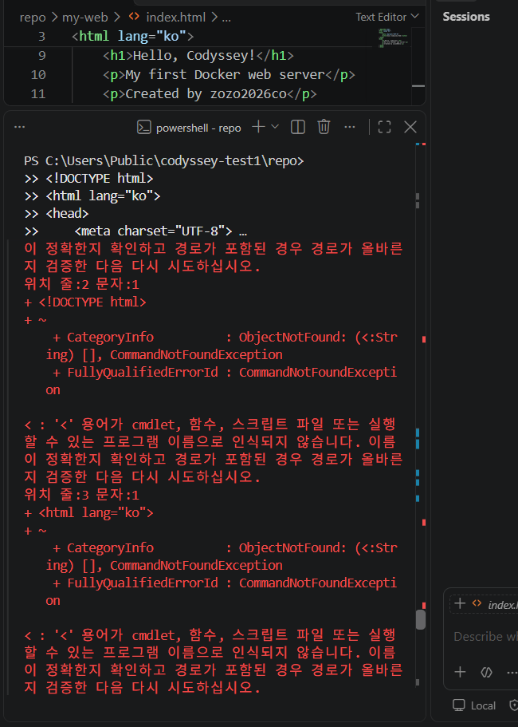

### 8.2. NGINX favicon.ico 404 오류

**문제 상황**

직접 제작한 웹 서버의 로그를 확인하던 중 다음 오류를 발견했습니다.

```text
GET /favicon.ico HTTP/1.1" 404
```

웹페이지 자체는 정상적으로 표시되었지만, 브라우저가 요청한 `favicon.ico` 파일이 없어서 발생한 오류였습니다.

**원인 확인**

NGINX 로그에 다음 메시지가 기록되었습니다.

```text
open() "/usr/share/nginx/html/favicon.ico" failed (2: No such file or directory)
```

해당 경로에 브라우저 아이콘 파일이 없다는 것을 확인했습니다.

**수정 과정**

`my-web/index.html`의 `<head>` 영역에 다음 코드를 추가했습니다.

```html
<link rel="icon" href="data:,">
```

이후 수정한 HTML을 포함하도록 Docker 이미지를 다시 빌드했습니다.

```powershell
docker build -t zozo-web:v2 .\my-web
```

새 이미지를 이용해 8082번 포트에서 웹 서버를 실행했습니다.

```powershell
docker run -d --name zozo-web-8082 -p 8082:80 zozo-web:v2
```

**수정 결과 확인**

브라우저에서 `http://localhost:8082`에 접속했을 때 웹페이지가 정상적으로 표시되었습니다.

```powershell
docker logs zozo-web-8082
```

로그에서는 `GET / HTTP/1.1" 200`을 확인했으며, 해당 접속 기록에는 기존 `favicon.ico 404` 오류가 나타나지 않았습니다.

다만 이번 결과는 확인한 브라우저 접속에 대한 것이므로, 모든 브라우저 환경에서 오류가 발생하지 않는다고 단정할 수는 없습니다.

**오류 발생 전 증거**

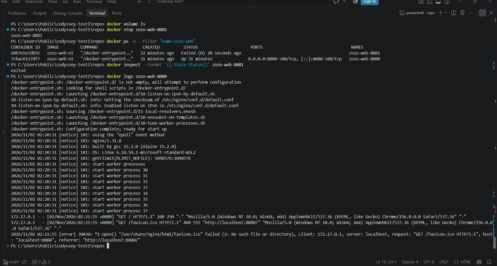

**수정 후 검증 증거**

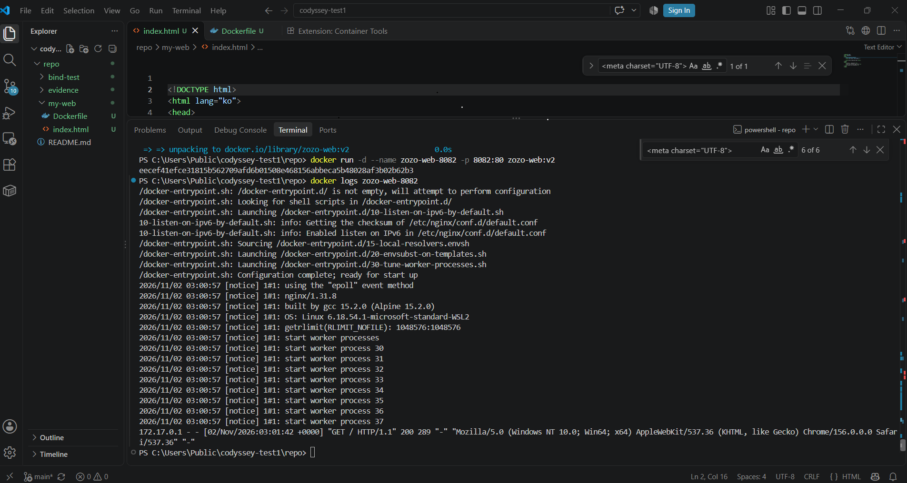

### 8.3. 실습을 통해 알게 된 점

처음에는 오류 메시지가 나타나면 무엇이 잘못되었는지 파악하기 어려웠습니다.

이번 과제에서는 오류 메시지를 그대로 확인하고, 관련 파일이나 설정을 수정한 뒤 같은 작업을 다시 실행해 보는 방식으로 문제를 해결했습니다.

특히 **문제 발생 화면과 수정 후 결과를 함께 남기는 것**이 실습 과정을 정리하는 데 도움이 되었습니다.

## 9. Docker attach와 exec 비교

이번 실습에서는 실행 중인 Ubuntu 컨테이너에 접속하는 두 가지 방법을 확인했습니다.

### 9.1. docker exec

```powershell
docker exec -it zozo-ubuntu bash
```

`docker exec`는 실행 중인 컨테이너에서 새로운 Bash 셸을 실행하는 명령어입니다.

직접 접속하여 기존에 생성한 파일과 권한 설정이 유지되어 있는 것을 확인했습니다.

### 9.2. docker attach

```powershell
docker attach zozo-ubuntu
```

`docker attach`는 실행 중인 컨테이너의 기존 주 프로세스에 연결하는 명령어입니다.

실제 실행 결과 Ubuntu의 `root@d06425053710:/#` 프롬프트가 표시되어 정상적으로 접속했습니다.

다만 VS Code에서 연결 해제 단축키를 사용하려고 했을 때 편집기의 단축키와 충돌하는 문제가 있었습니다. 이후 연결된 터미널 세션을 닫고 컨테이너 상태를 다시 확인했습니다.

```powershell
docker ps --filter "name=zozo-ubuntu"
```

확인 결과 `zozo-ubuntu` 컨테이너가 `Up` 상태로 계속 실행 중이었습니다.

### 9.3. 두 명령어의 차이

- **docker exec:** 실행 중인 컨테이너에 새로운 명령어 또는 셸을 실행합니다.
- **docker attach:** 컨테이너에서 이미 실행 중인 주 프로세스의 입출력에 연결합니다.

두 명령어 모두 직접 실행해 보았고, 연결 방식에 차이가 있다는 것을 확인했습니다.

## 10. GitHub 및 VS Code 연동 확인

이번 과제에서 작성한 README와 실습 파일, 증거 스크린샷을 GitHub 저장소에 업로드했습니다.

VS Code에서 GitHub 계정의 로그인 상태를 확인하고, Source Control 화면에서 현재 브랜치와 커밋 기록을 확인했습니다.

### 10.1. GitHub 업로드

다음 명령어로 실습 파일을 Git에 등록하고 GitHub에 업로드했습니다.

```powershell
git add README.md bind-test evidence file-practice my-web
git commit -m "Complete Codyssey Mission 1 development environment practice"
git push -u origin main
```

이후 Docker attach와 exec 실습 결과도 README에 추가하고 다시 커밋했습니다.

```powershell
git add README.md
git commit -m "Document Docker attach and exec practice"
git push
```

### 10.2. 동기화 확인

```powershell
git status -sb
```

실제 확인 결과:

```text
## main...origin/main
```

로컬 저장소와 GitHub의 커밋이 동기화된 것을 확인했습니다.

### 10.3. VS Code 연동 증거

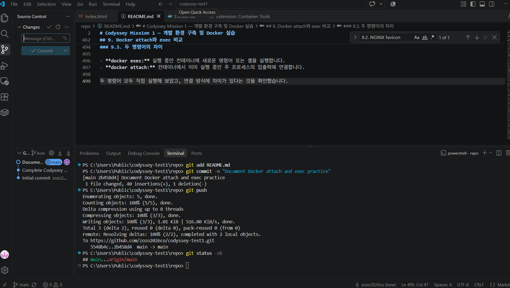

이번 실습을 통해 직접 작성한 파일을 Git에 기록하고 GitHub에 업로드하는 과정을 경험했습니다.

## 11. PowerShell 파일 및 디렉터리 관리 실습

이번 실습에서는 PowerShell을 이용해 폴더와 파일을 생성하고, 내용을 확인하거나 복사·이동·이름 변경·삭제하는 작업을 진행했습니다.

### 11.1. 현재 경로 및 숨김 파일 확인

```powershell
Get-Location
Get-ChildItem -Force
```

실제 확인한 현재 경로는 다음과 같습니다.

```text
C:\Users\Public\codyssey-test1\repo
```

`Get-ChildItem -Force` 명령어를 실행했을 때 `.git` 숨김 폴더와 `README.md`, `my-web`, `evidence`, `bind-test` 등의 항목을 확인했습니다.

`-Force` 옵션을 사용하면 일반 목록에 표시되지 않는 숨김 파일과 폴더도 확인할 수 있습니다.

### 11.2. 파일 생성 및 내용 확인

```powershell
New-Item -ItemType Directory -Path .\file-practice
Set-Content -Path .\file-practice\original.txt -Value "Codyssey file management practice"
Get-Content .\file-practice\original.txt
```

실제 출력 결과:

```text
Codyssey file management practice
```

### 11.3. 파일 복사와 이름 변경

```powershell
Copy-Item .\file-practice\original.txt .\file-practice\copy.txt
Get-ChildItem .\file-practice
```

실제 파일 목록에서 `copy.txt`와 `original.txt`가 각각 35바이트로 표시되었습니다.

이후 다음 명령어로 복사본의 이름을 변경했습니다.

```powershell
Rename-Item .\file-practice\copy.txt renamed.txt
Get-ChildItem .\file-practice
```

확인 결과 `copy.txt`가 사라지고 `renamed.txt`가 표시되었습니다.

### 11.4. 파일 이동

```powershell
New-Item -ItemType Directory -Path .\file-practice\moved-files
Move-Item .\file-practice\renamed.txt .\file-practice\moved-files\
Get-ChildItem .\file-practice\moved-files
```

실제 확인한 출력:

```text
디렉터리: C:\Users\Public\codyssey-test1\repo\file-practice\moved-files

Mode                 Length Name
----                 ------ ----
-a----                   35 renamed.txt
```

이후 원래 폴더에서 `Get-ChildItem .\file-practice`를 실행했을 때 `moved-files`와 `original.txt`만 표시되었습니다.

이를 통해 파일이 기존 위치에서 새 폴더로 이동되었음을 확인했습니다.

### 11.5. 파일 삭제

```powershell
Remove-Item .\file-practice\moved-files\renamed.txt
Get-ChildItem .\file-practice\moved-files
```

삭제 후 `moved-files` 폴더를 조회했을 때 파일 목록이 출력되지 않았습니다.

이번 실습으로 파일을 관리할 때 사용하는 기본 PowerShell 명령어를 직접 확인할 수 있었습니다.

---

## 12. Docker 이미지와 컨테이너의 차이

Docker를 처음 사용할 때는 이미지와 컨테이너의 차이가 헷갈렸습니다. 직접 이미지를 만들고 컨테이너를 실행하면서 두 개념을 구분할 수 있었습니다.

| 구분 | Docker 이미지(Image) | Docker 컨테이너(Container) |
|---|---|---|
| 개념 | 프로그램 실행에 필요한 파일과 설정을 묶은 실행 기반 | 이미지를 바탕으로 생성한 실행 환경 |
| 생성 | `docker build`, `docker pull` | `docker run`, `docker create` |
| 실행 상태 | 자체적으로 실행되지 않음 | 실행·중지·재시작 가능 |
| 삭제 | `docker rmi` | `docker rm` |
| 이번 실습 예시 | `zozo-web:v1`, `zozo-web:v2` | `zozo-web-8080`, `zozo-web-8081`, `zozo-web-8082` |

### 12.1. 이미지 제작

```powershell
docker build -t zozo-web:v1 .\my-web
```

Dockerfile과 HTML 파일을 바탕으로 `zozo-web:v1` 이미지를 만들었습니다.

### 12.2. 이미지로 컨테이너 생성

```powershell
docker run -d --name zozo-web-8080 -p 8080:80 zozo-web:v1
docker run -d --name zozo-web-8081 -p 8081:80 zozo-web:v1
```

같은 이미지로 이름과 호스트 포트가 서로 다른 두 컨테이너를 실행했습니다.

### 12.3. 컨테이너 중지

```powershell
docker stop zozo-web-8081
docker inspect --format '{{.State.Status}}' zozo-web-8081
```

실제 상태 확인 결과:

```text
exited
```

**정리하면 이미지는 실행에 필요한 기반이고, 컨테이너는 그 이미지를 실제 실행하는 환경입니다.**

컨테이너를 삭제하더라도 이미지 자체는 별도로 관리됩니다. 다만 컨테이너 내부에만 저장한 데이터는 삭제 시 사라질 수 있으므로, 유지해야 하는 데이터는 Bind Mount나 Volume에 저장해야 합니다.

---

## 13. Docker 네트워크와 포트 연결 이해하기

### 13.1. 컨테이너의 네트워크 공간

Docker 컨테이너는 일반적으로 호스트와 구분된 네트워크 환경에서 실행됩니다.

Linux의 **네트워크 네임스페이스(Network Namespace)**는 프로세스가 사용하는 네트워크 인터페이스, IP 주소, 라우팅 정보 등을 분리하는 기능입니다.

Docker는 이러한 기능을 이용해 컨테이너에 별도의 네트워크 환경을 제공할 수 있습니다.

따라서 컨테이너 안에서 웹 서버가 실행 중이더라도, Windows 브라우저에서 해당 서버에 접근하려면 적절한 네트워크 연결 설정이 필요합니다.

### 13.2. 포트 매핑

실습에서 사용한 명령어는 다음과 같습니다.

```powershell
docker run -d --name zozo-web-8080 -p 8080:80 zozo-web:v1
```

`-p 8080:80`의 의미는 다음과 같습니다.

- `8080`: Windows PC에서 접속할 호스트 포트
- `80`: Docker 컨테이너 내부에서 NGINX가 사용하는 포트

브라우저가 `http://localhost:8080`으로 접속하면 Docker의 포트 게시 설정을 통해 컨테이너 내부의 80번 포트로 요청이 전달됩니다.

실제로 8080번과 8081번 포트에서 웹페이지가 정상적으로 열리는 것을 확인했습니다.


### 13.3. HTTP 응답 확인

브라우저 접속뿐 아니라 웹 서버 로그에서도 응답 상태를 확인했습니다.

```powershell
docker logs zozo-web-8080
```

실제 확인된 로그:

```text
"GET / HTTP/1.1" 200 250
```

`200`은 요청이 성공했다는 HTTP 상태 코드입니다.

추가로 HTTP 응답을 직접 확인할 때는 PowerShell에서 다음 명령어를 사용할 수 있습니다.

```powershell
curl.exe -I http://localhost:8080
```

이 명령어는 HTTP 응답 헤더를 확인하는 방법입니다. README에 작성한 시점에는 해당 명령어의 실제 출력 결과를 별도로 확보하지 않았으므로, 실행 결과는 기록하지 않았습니다.

---

## 14. Docker 포트 충돌 확인 및 해결 방법

웹 서버를 실행할 때는 호스트 포트가 이미 사용 중이면 포트 연결에 실패할 수 있습니다.

이번 실습에서는 8080, 8081, 8082 포트를 각각 구분하여 사용했습니다. 실제 포트 충돌 오류가 발생한 것은 아니지만, 문제가 발생했을 때 확인할 수 있는 절차를 정리했습니다.

### 14.1. 현재 실행 중인 컨테이너 확인

```powershell
docker ps
```

`PORTS` 열에서 어떤 컨테이너가 어떤 호스트 포트를 사용하고 있는지 확인할 수 있습니다.

### 14.2. Windows에서 포트 점유 확인

예를 들어 8080번 포트를 확인할 때는 다음 명령어를 사용할 수 있습니다.

```powershell
netstat -ano | findstr :8080
```

출력된 PID를 이용해 해당 프로세스 정보를 확인할 수 있습니다.

```powershell
tasklist /FI "PID eq <확인한_PID>"
```

여기서 `<확인한_PID>`는 실제 `netstat` 결과에서 확인한 숫자로 바꿔 입력해야 합니다.

### 14.3. 충돌 해결

포트를 사용 중인 프로그램이나 컨테이너를 확인한 후 다음 방법 중 하나를 선택할 수 있습니다.

1. 필요하지 않은 Docker 컨테이너라면 `docker stop 컨테이너이름`으로 정상 종료합니다.
2. 기존 서비스를 유지해야 한다면 새 컨테이너의 호스트 포트를 변경합니다.
3. 다시 실행한 후 `docker ps`로 포트 매핑을 확인합니다.
4. 브라우저에서 변경한 포트로 접속하여 확인합니다.

예를 들어 8080번 포트가 이미 사용 중이라면 다음과 같이 다른 포트를 사용할 수 있습니다.

```powershell
docker run -d --name zozo-web-8083 -p 8083:80 zozo-web:v1
```

위 명령어는 포트 충돌을 해결하는 **예시**이며, 실제 이번 실습에서 실행한 명령어는 아닙니다.

특히 공용 PC에서는 어떤 프로세스인지 확인하지 않고 강제로 종료하면 다른 사용자의 작업에 영향을 줄 수 있으므로 주의해야 합니다.

---

## 15. Docker Volume 백업 및 복원 전략

### 15.1. Volume이 필요한 이유

이번 실습에서는 `zozo-data` 볼륨에 파일을 저장한 뒤 컨테이너를 삭제했습니다.

이후 새로운 컨테이너에서 같은 볼륨을 연결했을 때 기존 파일이 유지되는 것을 확인했습니다.

```powershell
docker run --rm -v zozo-data:/data ubuntu cat /data/saved.txt
```

실제 출력:

```text
Zozo Docker volume persistence test
```


### 15.2. 데이터 유지와 백업의 차이

Volume에 저장된 데이터는 일반적인 컨테이너 삭제와 별도로 유지할 수 있습니다.

하지만 **컨테이너 삭제 후 데이터가 유지되는 것과 백업이 존재하는 것은 다릅니다.**

Volume 자체가 삭제되거나 데이터가 손상될 가능성에 대비하려면 별도의 백업 파일을 보관해야 합니다.

### 15.3. Volume 백업 방법

Docker Volume을 백업하는 한 가지 방법은 임시 컨테이너를 실행해 Volume 내용을 `tar` 압축 파일로 저장하는 것입니다.

다음은 `zozo-data` 볼륨을 백업하는 예시입니다.

```powershell
docker run --rm -v zozo-data:/data:ro --mount "type=bind,source=C:\Users\Public\codyssey-test1\repo,target=/backup" ubuntu tar -czf /backup/zozo-data-backup.tar.gz -C /data .
```

이 명령어의 의미는 다음과 같습니다.

- `zozo-data:/data:ro`: 기존 Volume을 읽기 전용으로 연결
- `/backup`: Windows 프로젝트 폴더를 컨테이너에 연결
- `tar -czf`: Volume 내용을 압축 파일로 생성
- `-C /data .`: `/data` 폴더 안의 파일들을 백업

백업 파일이 생성되었다면 원본 Volume과 분리된 저장 위치에 보관하는 것이 좋습니다.

### 15.4. 복원 방법

백업 파일을 새로운 볼륨에 복원하는 방법도 있습니다.

먼저 복원용 볼륨을 생성합니다.

```powershell
docker volume create zozo-data-restored
```

그다음 압축 파일을 새 볼륨에 풀 수 있습니다.

```powershell
docker run --rm -v zozo-data-restored:/data --mount "type=bind,source=C:\Users\Public\codyssey-test1\repo,target=/backup" ubuntu tar -xzf /backup/zozo-data-backup.tar.gz -C /data
```

위 백업 및 복원 명령어는 **향후 활용할 수 있는 방법을 정리한 예시**입니다. 이번 과제에서 실제로 검증한 것은 Volume 생성과 컨테이너 삭제 후 데이터 유지까지입니다.

실제 서비스 데이터를 백업할 때는 데이터의 일관성을 위해 쓰기 작업을 중단하거나 애플리케이션에 맞는 백업 방법을 적용할 필요가 있습니다.

---

## 16. Linux 접근 권한 이해하기

Ubuntu 컨테이너에서는 파일과 디렉터리의 권한을 직접 변경했습니다.

### 16.1. 권한의 기본 의미

| 기호 | 의미 | 숫자 |
|---|---|---:|
| `r` | 읽기(Read) | 4 |
| `w` | 쓰기(Write) | 2 |
| `x` | 실행(Execute) | 1 |
| `-` | 해당 권한 없음 | 0 |

각 권한의 숫자를 합산하여 한 자리 숫자로 나타냅니다.

예를 들어:

- `7 = 4 + 2 + 1` → 읽기, 쓰기, 실행
- `6 = 4 + 2` → 읽기, 쓰기
- `5 = 4 + 1` → 읽기, 실행
- `4` → 읽기만 허용

Linux의 일반적인 권한 표기는 **소유자(User), 그룹(Group), 기타 사용자(Others)** 순서로 표시됩니다.

### 16.2. 파일 권한 변경

실제 실행한 명령어:

```bash
ls -l practice.txt
chmod 744 practice.txt
ls -l practice.txt
```

실제 확인 결과:

```text
변경 전: -rw-r--r-- (644)
변경 후: -rwxr--r-- (744)
```

소유자에게 실행 권한이 추가된 것을 확인했습니다.

### 16.3. 디렉터리 권한 변경

```bash
mkdir permission_dir
ls -ld permission_dir
chmod 700 permission_dir
ls -ld permission_dir
```

실제 확인 결과:

```text
변경 전: drwxr-xr-x (755)
변경 후: drwx------ (700)
```

변경 후에는 그룹 및 기타 사용자의 접근 권한이 제거되었습니다.


권한의 숫자 표기와 문자 표기를 함께 비교하면서 `chmod` 명령어의 의미를 이해할 수 있었습니다.

---

## 17. Docker 실행 상태와 이미지·컨테이너 점검

### 17.1. Docker 엔진 확인

Docker 명령어가 설치되어 있는 것과 Docker 엔진이 실행 중인 것은 별개의 문제입니다.

실습 초기에는 Docker Desktop이 실행되지 않아 엔진에 연결할 수 없었습니다. Docker Desktop을 실행한 뒤 `docker info`가 정상적으로 작동하는 것을 확인했습니다.

확인 명령어:

```powershell
docker --version
docker info
```

실제 Docker CLI 버전:

```text
Docker version 29.9.2, build a82e528
```

또한 NGINX 컨테이너 실행 로그에서 다음 정보를 확인했습니다.

```text
nginx/1.31.8
OS: Linux 6.18.54.1-microsoft-standard-WSL2
```

위 내용은 NGINX 컨테이너 로그에 표시된 정보이며, Docker Engine 버전과는 구분해야 합니다.

### 17.2. 이미지 목록 확인

```powershell
docker images
```

실습 중 Ubuntu, NGINX, hello-world 이미지가 존재하는 것을 확인했습니다.

직접 생성한 웹 서버 이미지도 조회했습니다.

```powershell
docker images zozo-web
```

`zozo-web:v1` 이미지가 생성되었고, 이후 HTML을 수정하여 `zozo-web:v2` 이미지도 빌드했습니다.

### 17.3. 컨테이너 목록 확인

```powershell
docker ps
docker ps -a
```

- `docker ps`: 실행 중인 컨테이너 조회
- `docker ps -a`: 종료된 컨테이너까지 포함해 조회

실습 중에는 직접 만든 Ubuntu 및 NGINX 컨테이너의 실행 상태를 확인했습니다.

특히 `zozo-web-8081` 컨테이너를 중지한 뒤 다음 명령어로 상태를 조회했습니다.

```powershell
docker inspect --format '{{.State.Status}}' zozo-web-8081
```

실제 출력:

```text
exited
```

### 17.4. 로그와 자원 사용량 확인

```powershell
docker logs zozo-ubuntu
docker logs zozo-web-8080
docker stats --no-stream zozo-ubuntu
```

NGINX의 웹페이지 요청 로그에서는 `200` 응답을 확인했고, `docker stats`에서는 컨테이너의 CPU 및 메모리 사용량을 확인했습니다.


**추가 증거 보완 안내:** `docker info`, `docker images`, `docker ps -a`의 전체 출력 결과는 README에 아직 별도로 첨부하지 않았습니다. AI 사전평가에서는 해당 원본 출력이나 스크린샷을 추가하도록 요청했습니다.

---

## 18. Git 저장소 구조 및 실습 재현 방법

### 18.1. 프로젝트 폴더 구조

이번 과제에서 사용한 주요 파일 구조는 다음과 같습니다.

```text
codyssey-test1/
└── repo/
    ├── README.md
    ├── bind-test/
    │   └── message.txt
    ├── evidence/
    │   ├── docker_bind_mount.png
    │   ├── docker_hello_world.png
    │   ├── docker_stats.png
    │   ├── docker_volume_persistence.png
    │   ├── docker_web_8080.png
    │   ├── docker_web_8081.png
    │   ├── linux_file_permission.png
    │   ├── troubleshooting_html_powershell.png
    │   ├── troubleshooting_nginx_favicon_error.png
    │   ├── troubleshooting_nginx_favicon_fixed.png
    │   └── vscode_git_sync.png
    ├── file-practice/
    │   └── original.txt
    └── my-web/
        ├── Dockerfile
        └── index.html
```

`.git` 폴더는 Git이 관리하는 숨김 폴더이며, GitHub 저장소의 일반 파일 목록에는 표시되지 않습니다.

`README.backup.txt`는 원본을 보관하기 위해 로컬에 생성했지만 Git 제출 대상에서는 제외했습니다.

### 18.2. 웹 서버 실습 재현 체크리스트

다음 과정은 GitHub 저장소의 코드를 이용해 웹 서버를 다시 실행하기 위한 절차입니다.

- [ ] Git과 Docker Desktop이 설치되어 있는지 확인합니다.
- [ ] Docker Desktop을 실행하고 Docker 엔진이 정상적으로 작동하는지 확인합니다.
- [ ] GitHub 저장소를 복제합니다.
- [ ] 프로젝트 폴더로 이동합니다.
- [ ] Docker 이미지를 빌드합니다.
- [ ] 웹 서버 컨테이너를 실행합니다.
- [ ] 브라우저에서 웹페이지에 접속합니다.
- [ ] Docker 로그를 확인합니다.

**저장소 복제**

```powershell
git clone https://github.com/zozo2026co/codyssey-test1.git
cd codyssey-test1
```

**Docker 실행 상태 확인**

```powershell
docker info
```

**웹 서버 이미지 생성**

```powershell
docker build -t zozo-web:v1 .\my-web
```

**웹 서버 실행**

```powershell
docker run -d --name zozo-web-replay -p 8080:80 zozo-web:v1
```

**웹페이지 확인**

브라우저에서 다음 주소로 접속합니다.

`http://localhost:8080`

**로그 확인**

```powershell
docker logs zozo-web-replay
```

**컨테이너 중지**

```powershell
docker stop zozo-web-replay
```

이미 같은 이름의 컨테이너가 있거나 8080번 포트가 사용 중이라면 충돌할 수 있으므로, 기존 상태를 먼저 확인해야 합니다.

### 18.3. 경로와 재현성

이번 Bind Mount 실습에서는 실제 PC 경로를 직접 지정했습니다.

```text
C:\Users\Public\codyssey-test1\repo\bind-test
```

하지만 이 경로는 다른 사람의 PC에서는 존재하지 않을 수 있습니다.

일반적인 파일 작업에는 상대경로(`.\my-web` 등)를 사용하면 다른 위치에서도 동일한 프로젝트 구조를 활용하기 쉽습니다.

Bind Mount처럼 절대경로가 필요한 경우에는 자신의 프로젝트 경로로 바꿔 입력하거나 PowerShell의 현재 경로 변수를 활용하는 방식이 좋습니다.

---

## 19. 추가 확인 사항 및 실습 정리

### 19.1. 확인된 실습 결과

이번 과제에서 실제로 확인한 내용은 다음과 같습니다.

- Git 설치와 저장소 복제 및 GitHub Push
- Docker Desktop 실행과 hello-world 성공
- Ubuntu 컨테이너 생성 및 재접속
- Linux 파일·디렉터리 권한 변경
- Docker 이미지 제작과 NGINX 웹 서버 실행
- 8080·8081·8082 포트를 이용한 웹 접속
- Docker 컨테이너 로그와 자원 사용량 확인
- Bind Mount로 파일 변경 사항 공유
- Docker Volume의 데이터 유지 확인
- PowerShell 파일 생성·복사·이동·이름 변경·삭제
- 트러블슈팅 2건의 수정 과정 및 결과 확인
- VS Code GitHub 계정 로그인 및 소스 제어 화면 확인
- README 작성 및 GitHub 동기화

### 19.2. 추가로 보완할 증거

AI 사전평가에서 요구한 자료 중 다음 항목은 실제 출력이나 스크린샷을 추가로 확보하면 더 명확하게 검증할 수 있습니다.

- [ ] `docker info` 실행 출력
- [ ] `docker images` 실행 출력
- [ ] `docker ps -a` 실행 출력
- [ ] Docker 이미지 빌드 성공 로그
- [ ] `docker volume ls` 실행 출력
- [ ] `git remote -v` 실행 출력
- [ ] HTTP 응답 확인 명령 실행 출력

일부 명령어는 이미 실습했지만, README에는 실제 출력 원문이 충분히 남아 있지 않습니다. 따라서 추가 검증이 필요합니다.

### 19.3. 실습을 마치며

이번 과제에서는 개발 환경을 설치하는 것부터 Docker 컨테이너를 실행하고 GitHub에 결과물을 올리는 과정까지 직접 진행했습니다.

익숙하지 않은 명령어가 많아 중간에 오류도 있었지만, 명령어를 실행한 후 결과를 확인하고 잘못된 부분을 수정하면서 실습을 이어갈 수 있었습니다.

특히 Docker 이미지와 컨테이너의 차이, 파일 권한, 포트 연결, 데이터 저장 방식 등은 실제로 명령어를 실행해 보면서 조금 더 명확하게 이해할 수 있었습니다.

앞으로도 새로운 도구를 사용할 때는 실행 결과를 확인하고, 오류가 발생하면 그 내용을 기록하면서 해결하는 방식으로 학습하려고 합니다.

## 20. AI 사전평가 보완 — Docker 실행 증거

AI 사전평가에서 Docker 엔진의 실행 정보와 이미지·컨테이너 목록에 대한 실제 출력 증거가 부족하다는 피드백을 받았습니다.

이에 따라 관련 명령어를 다시 실행하고 결과를 스크린샷으로 저장했습니다.

### 20.1. Docker 엔진 동작 확인

```powershell
docker info
```

Docker 엔진이 정상적으로 실행되고 있음을 확인했습니다.

추가로 필요한 정보만 출력하도록 다음 명령어를 실행했습니다.

```powershell
docker info --format 'Server Version: {{.ServerVersion}} | Containers: {{.Containers}} | Images: {{.Images}} | Operating System: {{.OperatingSystem}}'
```

실제 출력 결과:

```text
Server Version: 29.9.2 | Containers: 7 | Images: 5 | Operating System: Docker Desktop
```

**실행 증거**

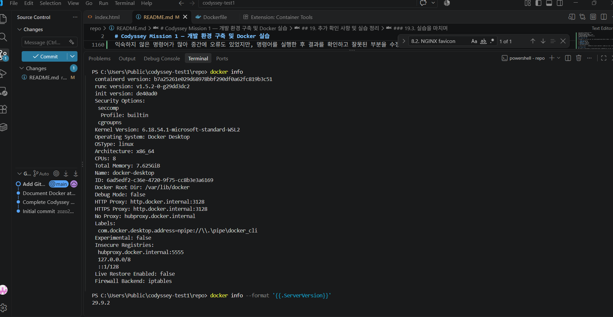

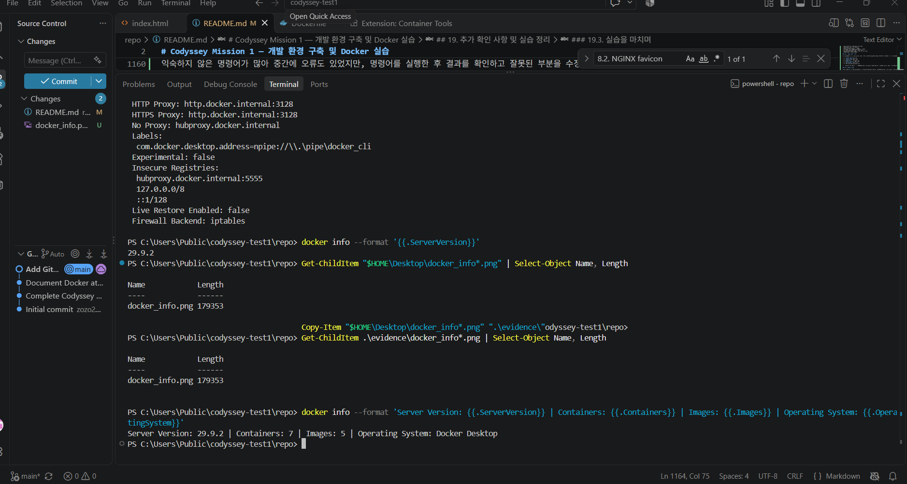

### 20.2. Docker 이미지 목록 확인

```powershell
docker images
```

실제 조회된 이미지:

```text
hello-world:latest
nginx:alpine
ubuntu:latest
zozo-web:v1
zozo-web:v2
```

총 5개의 이미지가 조회되었습니다.

**실행 증거**

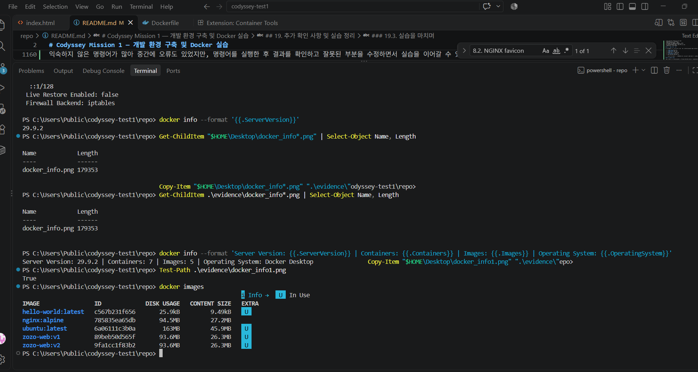

### 20.3. Docker 컨테이너 목록 확인

```powershell
docker ps -a
```

실제 확인 결과:

| 컨테이너 | 상태 |
|---|---|
| zozo-web-8082 | 실행 중 |
| zozo-web-8081 | 종료됨 |
| zozo-web-8080 | 실행 중 |
| zozo-ubuntu | 실행 중 |
| vigorous_maxwell | 종료됨 |
| my-ubuntu | 종료됨 |
| dazzling_jackson | 종료됨 |

총 7개의 컨테이너가 조회되었습니다.

**실행 증거**

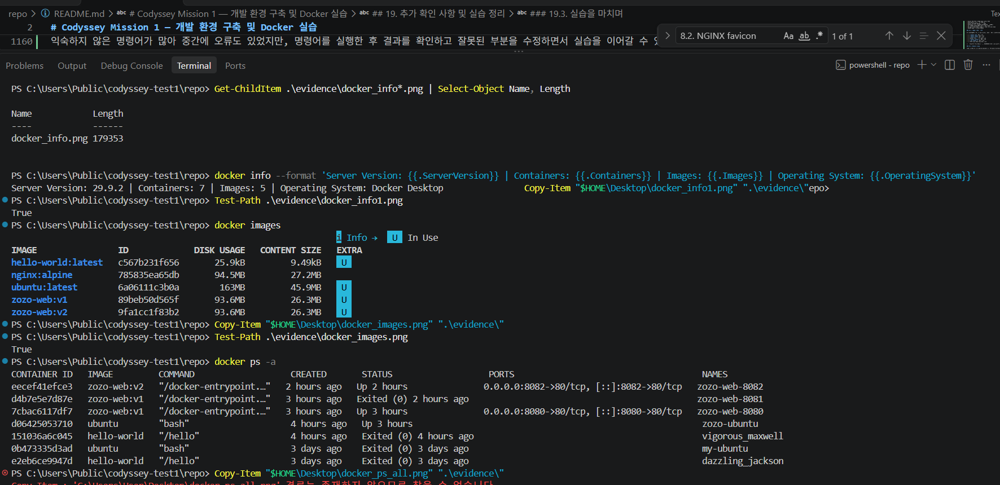

이번 보완을 통해 Docker 관련 명령어뿐 아니라 실제 실행 결과까지 README에 기록했습니다.

## 21. GitHub 원격 저장소 연결 확인

GitHub에 실습 자료를 업로드한 후, 로컬 Git 저장소가 올바른 원격 저장소에 연결되어 있는지 확인했습니다.

```powershell
git remote -v
```

실제 출력 결과:

```text
origin  https://github.com/zozo2026co/codyssey-test1.git (fetch)
origin  https://github.com/zozo2026co/codyssey-test1.git (push)
```

`fetch`와 `push` 주소가 모두 과제용 GitHub 저장소를 가리키고 있음을 확인했습니다.

또한 `git push` 실행 결과에서 `main -> main`이 표시되었으며, `git status -sb` 명령어로 로컬 브랜치와 원격 브랜치의 동기화 상태도 확인했습니다.

## 22. HTTP 응답 확인 — AI 사전평가 보완

AI 사전평가에서 브라우저 접속 스크린샷은 인정되었지만, 명령어를 이용한 HTTP 응답 확인 결과가 부족하다는 피드백을 받았습니다.

이에 따라 PowerShell에서 `curl.exe`를 이용해 직접 제작한 NGINX 웹 서버의 응답을 확인했습니다.

### 22.1. 실행 명령어

```powershell
curl.exe -I http://localhost:8080
```

`-I` 옵션은 HTTP HEAD 요청을 보내 응답 헤더를 확인하는 데 사용합니다.

### 22.2. 실제 터미널 출력

```text
HTTP/1.1 200 OK
Server: nginx/1.31.8
Date: Mon, 02 Nov 2026 05:38:29 GMT
Content-Type: text/html
Content-Length: 250
Last-Modified: Mon, 02 Nov 2026 02:12:12 GMT
Connection: keep-alive
ETag: "6ae7f17c-fa"
Accept-Ranges: bytes
```

### 22.3. 확인 결과

- **`HTTP/1.1 200 OK`**: 웹 서버가 HTTP 요청을 성공적으로 처리했습니다.
- **`Server: nginx/1.31.8`**: NGINX 웹 서버에서 응답했습니다.
- **`Content-Type: text/html`**: HTML 문서가 제공되고 있음을 확인했습니다.
- **`Content-Length: 250`**: 응답 헤더에 표시된 HTML 문서의 크기는 250바이트입니다.

앞서 브라우저에서 `http://localhost:8080`으로 접속하여 웹페이지가 표시되는 것을 확인했고, 이번에는 터미널에서도 HTTP 응답이 정상적으로 반환되는 것을 검증했습니다.

이를 통해 웹페이지의 동작 여부를 브라우저뿐 아니라 명령어로도 확인하는 방법을 익혔습니다.